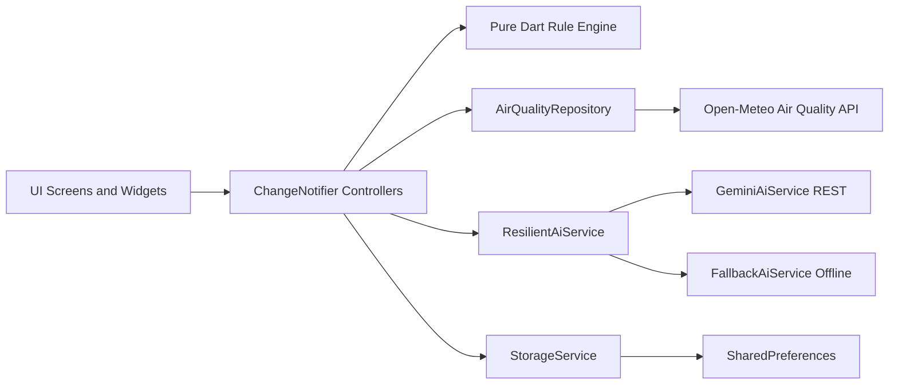

# Smog Shield

Practical GenAI-assisted urban air pollution and winter smog guidance for families, schools, and resident welfare associations (RWAs).

## 1. Overview

Smog Shield combines a deterministic, offline-capable public-health rule engine with optional Gemini narrative personalization so households in polluted cities receive realistic, low-cost routines, indoor air quality steps, and sustainable swaps backed by transparent impact estimates.

## 2. Chosen Vertical and Persona

- **Vertical**: Urban air pollution and winter smog navigation, designed around Delhi NCR and the Indo-Gangetic plain, with 15 curated Indian cities supported out of the box.
- **Persona**: A calm, practical public-health-minded neighbour helping non-experts (families with children under 12 or elders over 60, people with asthma or heart conditions, RWAs, schools, and local clubs) cut both personal PM2.5 exposure and neighbourhood emissions.

## 3. Approach and Logic

Smog Shield uses a hybrid architecture where the pure-Dart rule engine is always the source of truth and Gemini only personalizes wording on explicit user action without inventing AQI readings.

### CPCB AQI Bands and Base Risk Multipliers

| Band | AQI Range | Mask Guidance | Base Risk Multiplier |
| :--- | :--- | :--- | :--- |
| Good | 0 to 50 | None needed for air pollution | 1.00x |
| Satisfactory | 51 to 100 | Optional along heavy-traffic roads | 1.10x |
| Moderate | 101 to 200 | Carry fitted N95 for long commutes or sensitive members | 1.25x |
| Poor | 201 to 300 | Fitted N95/KN95 for commutes and errands | 1.45x |
| Very Poor | 301 to 400 | Fitted N95/N99 strongly advised outdoors | 1.75x |
| Severe | 401+ | Well-sealed N95/N99 essential for any outdoor trip | 2.00x |

Household vulnerability adds +0.25 for children under 12, +0.25 for adults over 60, and +0.20 per selected sensitivity, capped at 2.50x.

### Core Routine and Indoor Rules

| Trigger | Deterministic Recommendation |
| :--- | :--- |
| AQI 201+ (Poor to Severe) | Shift exercise indoors, wear fitted N95 outdoors, keep windows shut except a brief opening during the cleanest 2-hour window |
| Children under 12 | Child-sized fitted masks on school runs and indoor evening play above AQI 200 |
| Low budget, no purifier | Low-cost DIY box-fan plus MERV-13 filter option alongside damp mopping and door-gap sealing |
| Biomass or wood cooking | Critical swap to LPG, PNG, or single-burner induction and strict indoor burning ban |
| Two-wheeler or solo car | Mode shift to metro, closed bus, or carpool during high-smog days |

### Transparent Impact Assumptions

| Metric | Rule-of-Thumb Assumption |
| :--- | :--- |
| Cigarette-equivalent PM2.5 | 22.0 ug/m3 PM2.5 per day equals roughly 1 cigarette (Berkeley Earth rule of thumb) |
| Fitted N95 filtration | 85% conservative real-world PM2.5 filtration when properly sealed |
| HEPA air purifier | 60% indoor PM2.5 reduction in a closed room (45% for DIY box-fan MERV-13) |
| Clean cooking transition | 70% kitchen PM2.5 reduction moving from wood/biomass to clean fuel with exhaust |
| Commute swap | 2.4 kg CO2/day saved (solo car to metro) or 1.0 kg CO2/day (two-wheeler to metro) on a 15 km weekday round trip |

All numbers are explicitly labelled as estimates and never medical claims.

## 4. Architecture and How It Works



### Layer Dependency Rules

1. `core/` and `models/` have zero Flutter dependencies and depend on no upper layer.
2. `validation/` depends only on `core/` and `models/`.
3. `services/` rule engine modules (`aqi_service`, `forecast_service`, `routine_service`, `indoor_air_service`, `swap_service`, `impact_service`, `plan_builder`, `plan_exporter`) are pure Dart and depend only on `core/`, `models/`, and `validation/`.
4. `state/` controllers depend only on abstract service contracts (`AiService`, `AirQualityRepository`, `StorageService`) injected via constructors.
5. `ui/` widgets contain no business logic and read state via `Provider`.

## 5. Features

- **Household Profile**: City selection from 15 Indian cities, household counts, health sensitivities, commute mode, cooking fuel, home type, purifier ownership, budget level, inline validation, and optional manual AQI override.
- **Today Dashboard**: Asymmetric editorial AQI panel, who-is-at-risk summary, cleanest and worst 2-hour windows over the next 24 hours, top 3 actions, AI narrative card, and medical disclaimer.
- **Routine, Indoor Air, and Swaps Tabs**: Deterministically sorted actions, each with "Why this helps" and "How we estimated this".
- **Ask Tab**: Bounded 500-character Q&A grounded in the household profile and live reading, with offline topic fallback.
- **Export and Community Checklist**: Copy or share Markdown plans plus a persisted RWA and school checklist tailored to the active AQI band.
- **Settings**: Light, Dark, and High-Contrast themes, profile edit, data sources, disclaimer, and one-tap "Clear my data".

## 6. Setup and Run

### Web Preview and Express Server (Node.js 22+)

Install dependencies and configure `GEMINI_API_KEY` in environment secrets (leave `.env.example` values empty):

```bash
npm install
npm run dev
```

Build and verify the production bundle:

```bash
npm run lint
npm test
npm run test:coverage
npm run build
```

Ask queries use `POST /api/gemini/ask` with an ordered model fallback chain (`gemini-3.5-flash-lite` with minimal thinking -> `gemini-flash-latest`), a 10-second per-model server `AbortController` timeout, a 15-second client timeout, single-turn grounded context with the last 2 Q&A pairs, and instant deterministic **Quick Guidance** fallback when offline or unconfigured.

### Flutter Application (Android and Web)

If Android or Web platform folders are missing, generate them once:

```bash
flutter create --platforms=android,web .
flutter pub get
flutter run -d chrome --dart-define=GEMINI_API_KEY=your_key
flutter build web --release
flutter build apk --release
```

Run completely offline without an API key (uses the verified rule engine and offline narrative fallback):

```bash
flutter run -d chrome
```

## 7. Security Measures

- **Server-Side API Key Isolation**: The Express server (`server.ts`) reads `process.env.GEMINI_API_KEY` strictly on the server and never exposes keys to client bundles, logs, or UI inputs. `.env.example` contains empty values only, and `.gitignore` excludes `node_modules/`, `dist/`, `build/`, `coverage/`, `.env`, `.env.*`, and `*.key`.
- **HTTP Security Headers and Rate Limiting**: Express disables `X-Powered-By`, sets `X-Content-Type-Options: nosniff`, `Referrer-Policy`, `Permissions-Policy`, `X-DNS-Prefetch-Control`, and `Cross-Origin-Opener-Policy`, caps JSON payloads at 64 KB with malformed-JSON HTTP 400 handling, and applies a per-IP sliding-window rate limiter (20 requests/minute with HTTP 429 + `Retry-After`) to `/api/gemini/*`.
- **Prompt Injection Defense**: User questions are sanitized, stripped of control characters, capped at 500 characters, and wrapped inside `<user_question></user_question>` delimiters with system instructions restricting scope strictly to air quality and sustainability.
- **Flutter Client-Key Transparency**: For public Flutter deployments, route requests via `--dart-define=AI_PROXY_URL` instead of embedding a client key.
- **Privacy and Erasure**: Zero third-party analytics, local browser/device storage only, and a one-tap **Clear My Data** control in Settings that wipes profile, checklist, theme, air cache, and Ask session history.

## 8. Accessibility Measures

- Warm Light, Dark, and High-Contrast themes meeting WCAG AA contrast ratios (>= 4.5:1 across all surfaces).
- AQI status is always conveyed through color, a distinct shape icon, and explicit text labels.
- Semantic labels on custom visuals and controls (for example, "Air quality index 312, Severe"), `aria-live="polite"` announcements, `Escape` modal dismissal, full keyboard navigation, visible focus states, minimum 48x48 tap targets, reduced-motion progress indicator support, and pointer cursors on every interactive card, chip, and button.
- Verified layouts across 320 px, 600 px, and 1200 px widths and 200% zoom/text scaling with zero horizontal overflow.

## 9. Testing Approach and Commands

The TypeScript/Node suite (`src/*.test.ts`) covers CPCB AQI boundary mapping, 2-hour cleanest/worst window math, three realistic household personas (asthmatic child with biomass cooking at Severe AQI, healthy adult at Good AQI, elder with heart sensitivity at Poor AQI), impact notes, Markdown export, RWA/school/home checklists, Open-Meteo 503/offline/malformed-JSON fallbacks, 500+ character and prompt-injection input sanitization, 10-minute Ask caching, 15-second timeouts, AbortController cancellation, and 3-part structured advice parsing. The Flutter suite (`test/`) mirrors these unit and widget checks.

```bash
npm run lint
npm test
npm run test:coverage
npm run build
```

For Flutter environments:

```bash
dart format --output=none --set-exit-if-changed lib test
flutter analyze
flutter test --coverage
```

## 10. Assumptions

- Open-Meteo provides hourly US AQI, PM2.5, and PM10 readings mapped onto Indian CPCB band thresholds for family-friendly interpretation.
- Exposure and emission figures are transparent rule-of-thumb estimates rather than clinical measurements or medical advice.
- English copy only, local browser/device storage, and no hosted user database.

## 11. Limitations and Future Work

- Live readings come from regional air-quality models rather than hyperlocal room sensors; manual AQI entry bridges outages or indoor monitor readings.
- Future work includes Hindi and regional language localization, optional home-screen AQI alerts, and persistent cross-device sync.
